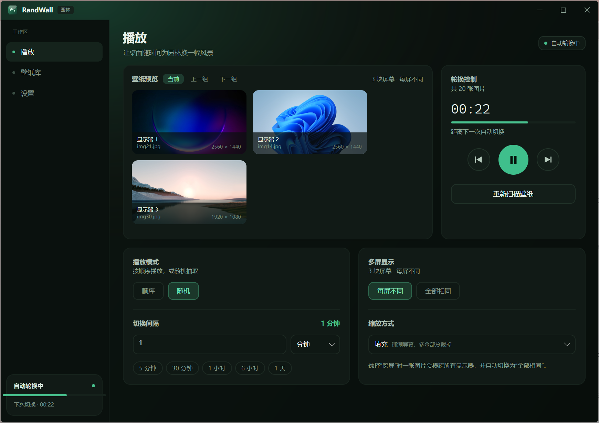
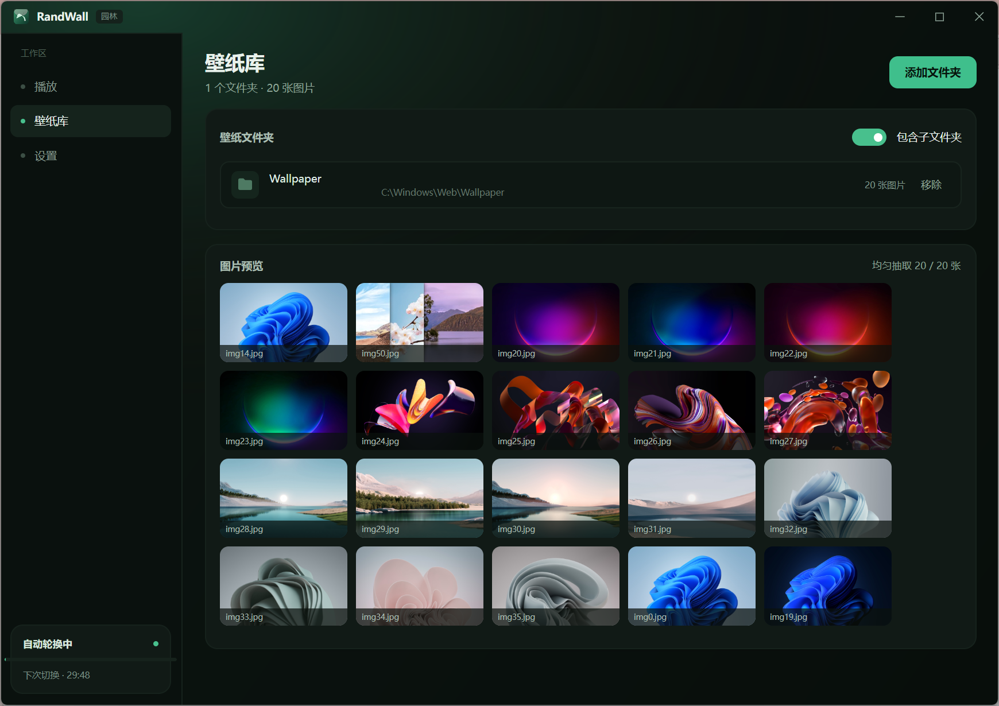
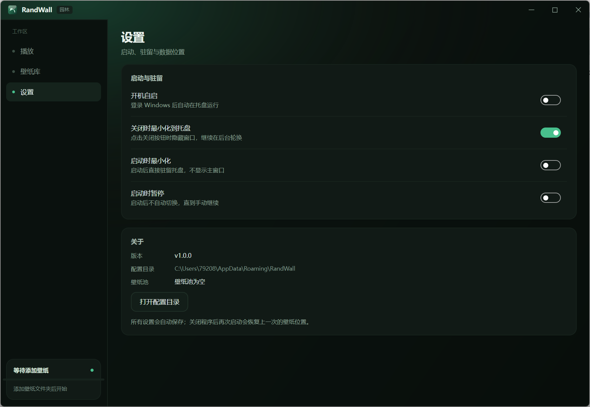
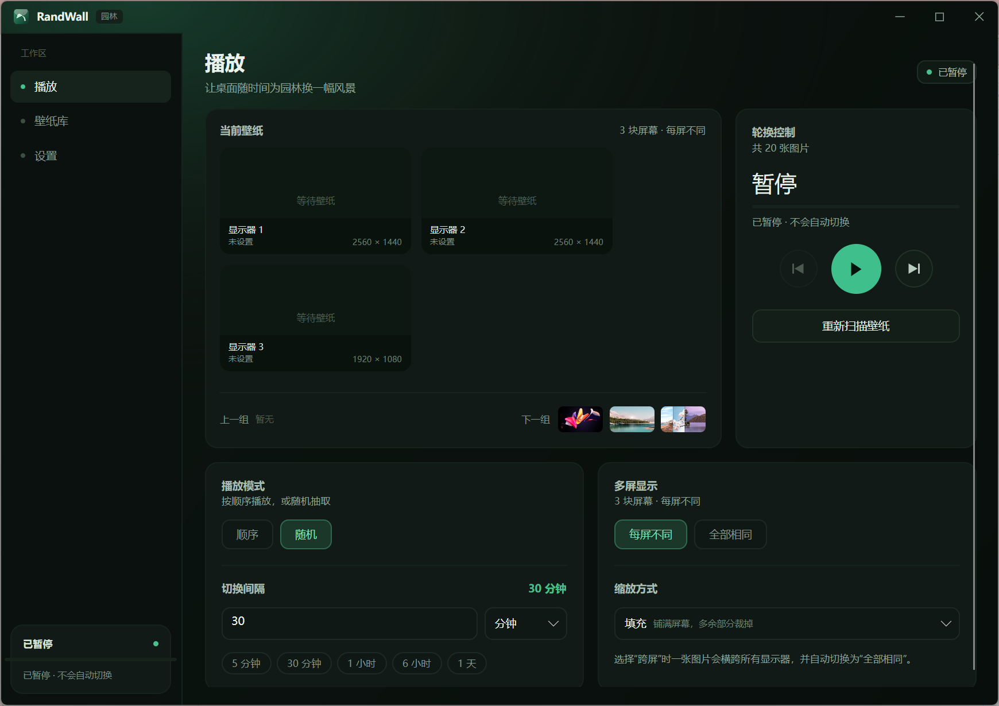

# RandWall · 园林

用 **Avalonia** 写的 Windows 壁纸轮换工具。把散落在各个文件夹里的壁纸收进一个池子，按时自动换上一组新风景。



## 功能

- **自动轮换**：间隔 1 分钟 ~ 30 天，可直接输入数字并选择「分钟 / 小时 / 天」，也保留常用预设。
- **整点基准**：开启后切换时间从整点起算（例如 24 分、间隔 10 分钟，下次在 30 分），而不是从现在起算；此时分钟单位只允许 60 的约数（1/2/3/4/5/6/10/12/15/20/30/60）。
- **多屏同时切换**：整组壁纸一次性应用到所有屏幕。
- **上一组 / 下一组查看**：「壁纸预览」标题处的页签可切换查看相邻两组，仅用于预览；真正切换仍由「轮换控制」里的按钮触发。随机模式下「下一组」页签旁有「重 roll」，可重新抽取预览。
- **直接定位文件**：壁纸预览卡片右上角的按钮可在资源管理器中定位当前图片；壁纸库的文件夹图标可直接打开该目录。
- **多文件夹壁纸池**：可添加任意多个文件夹，递归收集子文件夹中的图片。
- **两种播放模式**：顺序播放（按文件路径）/ 随机抽取（一整轮内不重复）。
- **随时控制**：暂停 / 继续、上一组、下一组、立即重新扫描。
- **多屏支持**：
  - 每屏不同：每块显示器各自轮换到不同图片；
  - 全部相同：所有屏幕使用同一张；
  - 缩放方式：填充 / 适应 / 拉伸 / 居中 / 平铺 / 跨屏。
- **托盘驻留**：关闭窗口时缩到托盘，托盘菜单可直接控制轮换。
- **开机自启**：写入当前用户的启动项，登录后自动在托盘运行。
- **状态记忆**：关闭后再次启动，会恢复上一次停留的壁纸与播放位置。

## 运行与发布

开发运行：

```powershell
dotnet run --project src/RandWall/RandWall.csproj
```

发布时，`publish` 目录是「框架依赖」产物：**必须把整个目录一起分发**，exe 不能单独拿走，目标机需要 [.NET 8 桌面运行时](https://dotnet.microsoft.com/download/dotnet/8.0)。运行时采用**向前滚动**策略：优先使用已安装的 8.0.x（取最高补丁）；如果目标机没装 8，会自动改用已安装的更高主版本（9 / 10）。也可以用脚本生成另外两种形态：

```powershell
.\scripts\publish.ps1              # 框架依赖目录（默认，体积最小）
.\scripts\publish.ps1 single       # 单个 exe，仍需 .NET 8 桌面运行时
.\scripts\publish.ps1 selfcontained # 单个 exe，自带运行时，目标机无需安装 .NET
```

| 形态 | 分发内容 | 目标机要求 |
| --- | --- | --- |
| framework（默认） | 整个 publish 目录（约 26 MB） | 已安装 .NET 8 桌面运行时（无 8 时自动用 9 / 10） |
| single | 单个 `RandWall.exe`（约 26 MB） | 已安装 .NET 8 桌面运行时（无 8 时自动用 9 / 10） |
| selfcontained | 单个 `RandWall.exe`（约 90 MB） | 无 |

首次启动后，进入「壁纸库」→「添加文件夹」，选择存放壁纸的目录即可开始自动轮换。

## 界面

- **播放**：壁纸预览（页签切换当前 / 上一组 / 下一组，按显示器分卡片，右上角按钮在资源管理器中定位图片）、倒计时、上一组 / 暂停 / 下一组按钮、播放模式、切换间隔（含整点基准开关）、多屏与缩放设置。
- **壁纸库**：文件夹列表与图片数量（点文件夹图标直接打开该目录）、是否包含子文件夹、图片缩略图墙（从壁纸池按路径均匀抽取最多 24 张，显示文件名）。
- **设置**：开机自启、关闭时最小化到托盘、启动时最小化、启动时暂停、配置目录。







窗口右上角的关闭按钮默认是「最小化到托盘」，要真正退出请用托盘菜单里的「退出 RandWall」。

## 数据与配置

| 内容 | 位置 |
| --- | --- |
| 配置 | `%AppData%\RandWall\settings.json` |
| 日志 | `%AppData%\RandWall\logs\app.log` |

配置采用原子写入，损坏时会自动备份为 `settings.broken.<时间戳>.json` 并回到默认配置。

支持的图片格式：`.jpg` `.jpeg` `.jfif` `.png` `.bmp` `.gif` `.webp` `.tif` `.tiff`（取静态首帧）。

## 实现要点

- **逐屏设置壁纸**：通过 COM 接口 `IDesktopWallpaper`（Windows 8+）按显示器设备路径设置，vtable 直接调用以避免额外的互操作依赖；调用放在专用 STA 线程上执行。
- **回退策略**：`IDesktopWallpaper` 不可用时退回 `SystemParametersInfo(SPI_SETDESKWALLPAPER)`，此时只作用于主屏。
- **轮换引擎**：顺序模式维护全局游标，随机模式使用洗牌袋（Fisher–Yates）保证一轮内不重复；记录每组壁纸的起始游标，使「上一组」能精确回退。
- **整点基准**：把时间轴按「对齐基准 + 间隔整数倍」切片，取下一个切片边界作为切换时刻（分钟→对齐当前整小时，小时→对齐当天 0 点，天→以固定参考日按天推进）。倒计时进度按本次实际周期计算；继续播放时会重新对齐。
- **下一组预览**：在快照当前游标/随机袋之后试算一组并回滚状态，因此页签里看到的「下一组」就是随后真正会切到的那组。
- **托盘**：Avalonia `TrayIcon` + `NativeMenu`，与窗口生命周期解耦，关窗后仍常驻。
- **单实例**：命名 `Mutex` 保证只有一个进程；再次启动时通过命名事件唤起已有窗口。
- **界面**：Fluent 深色主题 + 覆盖 `SystemAccentColor` 得到统一的园林绿，自绘标题栏与卡片样式。

## 目录结构

```
RandWall.sln
scripts/publish.ps1          发布脚本（framework / single / selfcontained）
docs/                        界面截图
src/RandWall/
  Program.cs                 程序入口、单实例
  App.axaml(.cs)             主题、服务装配、托盘
  Styles/AppStyles.axaml     控件主题与通用样式
  Views/                     主窗口与三个页面
  ViewModels/                页面状态与命令
  Models/                    配置、显示器、壁纸组
  Services/
    DesktopWallpaperService  多屏壁纸设置（COM + 回退）
    PlaybackEngine           轮换引擎
    WallpaperLibrary         文件夹扫描
    SettingsService          配置读写
    AutoStartService         开机自启
    ThumbnailService         缩略图缓存
    SingleInstance           单实例
  Assets/                    图标
```

## 已知限制

- 仅支持 Windows；多屏逐屏设置需要 `IDesktopWallpaper`（Windows 8 及以上）。
- 动态壁纸、视频壁纸不在支持范围内。
- 若系统开了「幻灯片放映」，系统的定时切换可能与 RandWall 互相覆盖，建议关闭系统幻灯片。
